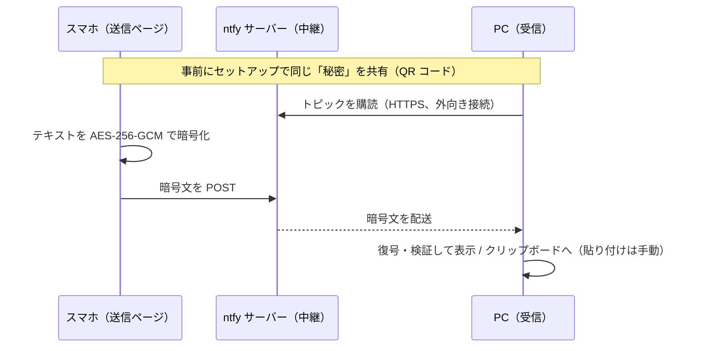

# voice-relay

スマホで入力したテキスト（音声入力キーボードで話した文章など）を、**エンドツーエンド暗号化**して PC に届けるツールです。PC 側はクリップボードに自動でコピーしておくこともできるので、スマホで話して PC で `Ctrl+V` するだけになります。

- 管理者権限・アプリのインストール・ポート開放は不要。外向きの HTTPS が通れば使えます（学校や会社の共有 PC でも）
- 中継サーバー（[ntfy](https://ntfy.sh)）には暗号文しか渡りません。秘密は自分のブラウザの中で作られ、誰とも共有しません

## クイックスタート

サイト: **https://takaho9.github.io/voice-relay/**

### A. PC で常駐させて、届いたら自動でクリップボードへ（おすすめ）

Linux デスクトップ（Ubuntu など）向けです。Python 3.9 以上が必要です。

1. **PC** のブラウザで https://takaho9.github.io/voice-relay/ を開く
2. **スマホ**のカメラで、画面の QR コードを読み取る。開いたページを**ホーム画面に追加**（またはブックマーク）する
3. **PC** のターミナルで次を実行する（ページの「コマンドをコピー」でコピーできます）

   ```sh
   python3 -m pip install --user --upgrade "cryptography>=50.0.2"
   git clone https://github.com/takaho9/voice-relay.git ~/voice-relay
   python3 ~/voice-relay/cli/voice_relay.py service install
   ```

4. 受信用 URL の貼り付けを求められたら、**PC** のページで「**受信用 URL をコピー**」を押し、ターミナルに貼り付けて Enter（画面には表示されません）
5. **スマホ**で話す（話し終えると自動で送信されます）→ PC に通知が出たら、貼り付けたい場所で `Ctrl+V`

これで完了です。次回からは PC にログインするだけで受信が始まり、スマホはホーム画面のアイコンから送れます。セットアップのページはもう閉じて構いません。

やめるときは `python3 ~/voice-relay/cli/voice_relay.py service uninstall`（常駐の解除）と `… forget`（秘密の削除）。

### B. ブラウザだけで使う（インストールなし）

1. **PC** のブラウザで https://takaho9.github.io/voice-relay/ を開く
2. **スマホ**で QR コードを読み取り、開いたページをホーム画面に追加する
3. **PC** のページで「**このタブで受信を開始**」を押す
4. **スマホ**で送ると PC の画面に表示されるので、「コピー」を押して貼り付ける

受信ページは秘密をブラウザに保存しないので、次回は受信ページに **受信用 URL** の貼り付けが必要です（セットアップのページで「受信用 URL をコピー」して、パスワードマネージャーなど安全な場所に控えておいてください）。

> **注意**: パスワードなどの機密は送らないでください。試験中など外部との通信が禁止されている場面では使わないでください。共有 PC での注意は[こちら](#注意事項)。

---

## 詳しい使い方

### スマホ（送信ページ）

- 開くとすぐ入力できる状態になります（Android の Chrome ではキーボードも自動で開きます。iPhone の Safari はブラウザの仕様でタップが必要です）
- 送信モードは 2 つあり、画面上部で切り替えます（選んだモードはスマホのブラウザに記憶されます）
  - **自動送信**（既定）: 入力が止まってから少し待つ（既定 1 秒、0.3〜3 秒で変更可）と、ボタンを押さなくても送信します。音声入力キーボードは話し終えた文章をまとめて入れるので、話し終えた直後に送られます。日本語の変換中（未確定の文字があるとき）は送りません。1 文字ごとに送らないのは、ntfy の 1 日あたりの通数制限をすぐ使い切らないためです
  - **手動送信**: 「送信」ボタン（または `Ctrl+Enter`）を押したときだけ送ります。送る前に見直したいとき向けです
- 送信に成功すると入力欄が空になります。失敗したときは入力内容が残り、理由が表示されます（自動送信モードでも自動では再送しません。「今すぐ送信」で送り直せます）
- 画面右上の **確認コード**（例 `3fa2-91bc`）が PC 側と同じなら、正しくペアになっています
- 長いテキストは自動で分割して送ります（最大で日本語約 7,600 文字）

### PC でターミナルを使って受信する

Python 版と Node.js 版があり、どちらも同じ形式・同じ秘密ファイル（`~/.config/voice-relay/secret`、権限 600）を使います。

| | 必要なもの | 秘密の作成 |
|---|---|---|
| **Python 版** `cli/voice_relay.py` | Python 3.9 以上 + `cryptography` 50.0.2 以上 | Web のセットアップページで作って `import` |
| **Node.js 版** `cli/voice-relay.mjs` | Node.js 20 以上（追加パッケージなし） | `setup`（ターミナルに QR コードを表示）または `import` |

`cryptography` は、AES-GCM と HKDF に使う定番の暗号ライブラリです。OS に古い版が入っていても `import` できてしまうので、`--upgrade` を付けて新しい版を入れてください（古い版だと起動時に警告が出ます）。

**Python 版のコマンド**

```sh
python3 cli/voice_relay.py import             # 受信用 URL を貼り付けて秘密を保存
python3 cli/voice_relay.py service install    # 常駐を登録（ログイン中ずっと受信し、届いたらクリップボードへ。未 import なら URL を尋ねる）
python3 cli/voice_relay.py service status     # 常駐の状態を見る
python3 cli/voice_relay.py service uninstall  # 常駐を解除
python3 cli/voice_relay.py receive            # 常駐させずに、このターミナルで受信して表示（Ctrl-C で終了）
python3 cli/voice_relay.py receive --copy     # 表示に加えてクリップボードにもコピー
python3 cli/voice_relay.py forget             # 保存した秘密を削除
```

**Node.js 版のコマンド**（常駐の登録には対応していません）

```sh
node cli/voice-relay.mjs setup            # 秘密を作って保存し、スマホ用の QR コードを表示
node cli/voice-relay.mjs import           # または、Web のセットアップページの受信用 URL を取り込む
node cli/voice-relay.mjs receive [--copy] # 受信（Ctrl-C で終了）
node cli/voice-relay.mjs forget           # 保存した秘密を削除
```

#### 常駐（`service install`）の動き

- systemd のユーザーサービス（`~/.config/systemd/user/voice-relay.service`）として登録し、ログインのたびに自動で起動します。systemd が使えない環境では、デスクトップの自動起動（`~/.config/autostart/voice-relay.desktop`）を使います。どちらも管理者権限は不要です
- 届いたテキストはクリップボードにコピーし、デスクトップ通知を出します。**通知にもログにも本文は出しません**（文字数と時刻だけ）。ログは `journalctl --user -u voice-relay -f` で見られます
- クリップボードへのコピーには `xclip`・`xsel`・`wl-copy` のどれかを使います。どれもなければ、Ubuntu のデスクトップに標準で入っている PyGObject（GTK）で代わりにコピーします
- 起動直後に届く直近 10 分の再送分はコピーしません（再起動のたびにクリップボードが上書きされないように）
- 同じ PC で受信プロセスが 2 つ動かないようにしています。常駐中に `receive` で中身を見たいときは、いったん `service uninstall` してください
- ホームディレクトリが複数の PC で共有されている環境（学校の PC など）では、どの PC にログインしても常駐します

#### その他（ターミナル版共通）

- 秘密はコマンドライン引数では受け取りません（共有マシンでは `ps` で他のユーザーに見えるため）。保存ファイルが他人から読める権限になっていたら、起動を拒否します
- 秘密を保存したくない場合は、`import` せずに `receive` を実行すると、起動時に受信用 URL を入力するプロンプトが出ます
- 受信したテキストに含まれる端末の制御文字（エスケープシーケンス）や見えない文字は、`⟦U+001B⟧` のような表記に置き換えて表示します
- 受信内容はファイルには保存しませんが、`receive` で表示した場合はターミナルのスクロールバック（や tmux などのログ）に残ります。クリップボード履歴ツールを使っていれば、そこにも残ります

<details>
<summary>管理者権限なしで Node.js を入れる（Linux x64。Python 版を使うなら不要）</summary>

```sh
mkdir -p ~/.local/opt && cd ~/.local/opt
BASE=https://nodejs.org/dist/latest-v22.x
FILE=$(curl -fsSL $BASE/SHASUMS256.txt | grep -o 'node-v[0-9.]*-linux-x64.tar.xz' | head -n1)
curl -fsSLO "$BASE/$FILE"
curl -fsSL $BASE/SHASUMS256.txt | grep " $FILE\$" | sha256sum -c -   # 改ざんがないか確認
tar -xJf "$FILE" && rm "$FILE"
export PATH="$HOME/.local/opt/${FILE%.tar.xz}/bin:$PATH"   # ~/.bashrc や ~/.zshrc にも追記
node --version
```

展開後は 200MB 弱あります。ホームディレクトリの容量制限に注意してください。
</details>

### PC でブラウザを使って受信する

- 受信ページは秘密をブラウザに保存しません（ページのメモリ上にだけ持ちます）。リロードしたときや別の日に使うときは、受信ページの入力欄に **受信用 URL** を貼り付けます。アドレスバーに貼ると閲覧履歴に残ることがあるので、入力欄を使ってください
- 届いたメッセージの「コピー」を押してから、貼り付け先で貼り付けます（自動で入力・実行することはありません）

### 長いテキスト

ntfy の 1 通あたりの上限（4,096 バイト）に収まるよう、長いテキストは自動で分割して送り、受信側で結合してから表示します。1 通に入るのはおよそ日本語 950 文字・英数字 2,800 文字で、最大 8 通（日本語で約 7,600 文字）まで送れます。それを超える場合は送信前にエラーになります。

## 仕組み



1. **セットアップ**で 256bit の秘密をランダムに生成し、送信ページの URL を QR コードで表示します。秘密は URL の `#` 以降（フラグメント）にだけ入っているので、ページを開いてもサーバーには送られません
2. 秘密から HKDF で **暗号鍵** と **ntfy のトピック名** を別々に派生します。トピック名は中継に使う「宛先」で、ここから暗号鍵は求められません
3. **送信ページ**はテキストを暗号化し、そのトピックに POST します
4. **受信側**はトピックを購読し、復号・検証できたものだけを受け付けます

```
セットアップ:  秘密 (256bit, ランダム)
                 ├─ HKDF-SHA256 (info: …/aes-256-gcm-key) → 暗号鍵
                 └─ HKDF-SHA256 (info: …/ntfy-topic)      → トピック名（32 文字）

送信:  平文 {id, 送信時刻, 分割番号, 分割数, 本文}
         → AES-256-GCM（メッセージごとにランダムな 96bit IV）
         → base64url( バージョン(1) | IV(12) | 暗号文 + タグ(16) ) を ntfy に POST
```

## 脅威モデル

### 守れるもの

| 想定する相手 | 対策 |
|---|---|
| **中継サーバー（ntfy）とその運営者・経路上の盗聴者** | 本文は端末間で暗号化（AES-256-GCM）しているので、中継サーバーは内容を読めません |
| **トピック名を知った第三者**（ntfy.sh のトピックは誰でも購読・投稿できる） | 購読しても暗号文しか見えません。トピック名は暗号鍵とは別に派生しているので、トピック名から鍵は分かりません |
| **偽造・改ざん** | 認証付き暗号（GCM のタグ）で検証し、失敗したものは黙って捨てます。鍵を持たない人は、受信側に表示されるメッセージを作れません |
| **リプレイ（同じ暗号文の再送）** | 平文に送信時刻とランダムな ID を入れています。受信側は、同じ ID の 2 回目と、10 分より古いもの（または 2 分より未来のもの）を捨てます |
| **受信内容による攻撃（XSS・端末の操作）** | 受信テキストは HTML として解釈せず（`textContent`）、ターミナルでは制御文字を無害化して表示します |
| **見た目と中身の食い違い** | 制御文字・表示の向きを変える文字・幅ゼロの文字・タグ文字などは、ブラウザでも CLI でも `⟦U+202E⟧` のような表記で表示し、警告を出します（コピーされるのは元の文字列です） |
| **悪意のある中継サーバーからの過大なデータ** | 1 行の大きさに上限を設け、超えたら切断して再接続します |

### 守れないもの

- **端末そのものの侵害**: スマホや PC がマルウェアに感染している、画面をのぞかれている、などの場合は守れません
- **配信されるコードの改ざん**: このページのコードを配信しているリポジトリや GitHub アカウントが乗っ取られて悪意のあるコードに置き換えられると、秘密や平文を抜き取られます。気になる場合は、自分でフォークしてデプロイするか、CLI だけを使ってください
  - GitHub Pages では、同じアカウントのすべてのプロジェクトが `https://<ユーザー名>.github.io` という 1 つのオリジンを共有します。同じアカウントの別のページに脆弱性があると、このツールにも影響しうるので、フォークする場合は他のページを置いていないアカウントか、独自ドメインを使うと安全です
- **秘密（送信ページ・受信用 URL）の漏洩**: URL を知っている人は、メッセージを読むことも、偽のメッセージを送ることもできます
  - 送信ページの URL は、スマホのブックマークや閲覧履歴に残ります。ブラウザの同期機能を使っていれば、同期先にも保存されます
  - 漏れた可能性があるときは、セットアップをやり直して新しい秘密を作ってください（古い秘密は使えなくなります）
- **メタデータ**: 中継サーバーからは、送受信した IP アドレス、時刻、おおよその文字数（暗号文の長さ）、通数が見えます
- **配送の保証**: 中継サーバーは、メッセージを捨てたり遅らせたりできます（読んだり書き換えたりはできません）。トピック名を知っている人（中継サーバーを含む）が大量に投稿すると、受信が遅くなったり、ntfy の上限に達したりすることもあります
- **時計のずれ**: 送信側と受信側の時計が 10 分以上（未来方向は 2 分以上）ずれていると、メッセージは古すぎる（未来すぎる）ものとして黙って捨てられます。通常はどちらも自動で時刻合わせされているので問題になりません
- **10 分以内の再表示**: 受信ページを開き直すと、直近 10 分のメッセージがもう一度表示されます。これはリロード対策の仕様です。そのため中継サーバーが、10 分以内の暗号文を新しく開いた受信ページに再送することもできます

## 注意事項

- **パスワード・秘密鍵・個人情報などの機密は送らないでください。** 暗号化はしていますが、送信ページを開いた端末や、貼り付け先にも残ります
- **試験中や、外部との通信が禁止されている場面では使わないでください**
- **共有 PC では**:
  - 受信ページは使い終わったら「終了して秘密を消去」を押してからタブを閉じ、必要に応じて閲覧履歴も消してください。受信ページは秘密をブラウザに保存しないので、「閉じたタブを開き直す」で復元されることはありませんが、ページを開いたままにすると誰でも読めます
  - 受信用 URL は、共有 PC のファイル・メモ・チャットに残さないでください
  - CLI の秘密ファイル（`~/.config/voice-relay/secret`）を置くのは、ホームディレクトリが自分専用の場合だけにしてください。不要になったら `forget` で消せます
  - 受信したテキストをクリップボードにコピーしたままにしないでください
  - 常駐（`service install`）させていると、席を離れている間に届いたものもクリップボードに入ります。席を離れるときは画面をロックし、使い終わったらログアウトしてください（ログアウトすると常駐も止まります）
- **ntfy.sh の利用制限**: 匿名利用の上限は **IP アドレス単位** です（1 日 250 通・同時購読 30 本・短時間の連続リクエスト 60 回まで。[公式ドキュメント](https://docs.ntfy.sh/publish/#limitations)）。学校や会社の Wi-Fi のように**多くの人が同じグローバル IP を共有する環境では、他の利用者と上限を分け合う**ことになります
  - 「レート制限に達しました（429）」と表示されたら、スマホをモバイル回線に切り替えるか、時間をおいてください
  - よく使う場合は、ntfy を自分でホストすることを検討してください（[下記](#ntfy-を自分でホストする)）

## 自分でデプロイする

ビルドは不要です。リポジトリのファイルをそのまま GitHub Pages で配信します。

1. このリポジトリをフォークする
2. フォークしたリポジトリの **Settings → Pages** で、**Source: Deploy from a branch**、**Branch: `main` / `(root)`** を選んで保存する
3. 数分後に `https://<ユーザー名>.github.io/voice-relay/` で開けるようになる
4. 必要なら次の 2 か所を自分の URL に書き換える
   - `index.html` 末尾の「ソースコードと説明（README）」のリンク
   - `cli/voice-relay.mjs` の `DEFAULT_PAGES_URL`（CLI の `setup` が QR コードに入れる URL）。書き換えずに、環境変数 `VOICE_RELAY_PAGES_URL` や `--pages` オプションで指定しても構いません

GitHub Pages 以外でも、HTTPS で静的ファイルを配信できる場所ならどこでも動きます（WebCrypto とクリップボード API は HTTPS が必要）。手元で試すなら `python3 -m http.server --bind 127.0.0.1` で開いた `http://127.0.0.1:8000/` でも動きます。

## ntfy を自分でホストする

ntfy.sh の利用制限を避けたい場合や、中継サーバーも自分で管理したい場合は、ntfy を自分でホストできます（[ntfy のインストール手順](https://docs.ntfy.sh/install/)）。

- **ntfy は v2.22.0 以上（できれば最新版）を使ってください。** それより前の版には、リモートからコードを実行される脆弱性があります（[CVE-2026-39087](https://nvd.nist.gov/vuln/detail/CVE-2026-39087)。通知のアクションボタンを指定するヘッダーの解析処理の欠陥）
- **HTTPS で公開してください**（ブラウザから接続するため）
- ブラウザから直接 POST・購読するので、**CORS が許可されている必要があります**。ntfy は既定で全オリジンを許可しています
- このツールが使う ntfy の機能は、匿名でのトピックへの POST と、JSON ストリームでの購読（`/<topic>/json?since=…`）だけです。アクセス制御（ユーザー認証）を有効にする場合は、匿名での読み書きを許可したままにしてください（このツールは認証に対応していません）
- `message-size-limit` は既定の 4K のままで構いません。リバースプロキシの後ろに置く場合は `behind-proxy: true` を設定してください（設定しないとレート制限で全員が 1 人として数えられます）
- 受信ページを開き直したときに直近 10 分のメッセージを受け取るため、`cache-duration` を 0 にしないでください

使うときは、セットアップページの「設定」で ntfy サーバーの URL（例 `https://ntfy.example.com`）を入力して「適用」を押します。サーバー URL は秘密と一緒に送信ページ・受信用 URL に含まれるので、スマホや受信側で設定し直す必要はありません。CLI では `node cli/voice-relay.mjs setup --server https://ntfy.example.com` のように指定します。

## セキュリティ上の設計

- 暗号処理はすべてブラウザ / Node 組み込みの WebCrypto（`crypto.subtle`）、Python 版は `cryptography` パッケージで行い、自前の暗号実装はしていません（`js/crypto.js`、`cli/voice_relay.py`）
- 秘密は URL のフラグメントにだけ置きます。フラグメントは HTTP リクエストにも Referer にも含まれません。各ページは `<meta name="referrer" content="no-referrer">` も設定しています
- 送信ページが `localStorage` に保存するのは送信モードと待ち時間だけで、秘密は URL（ブックマーク）にしか置きません
- 受信ページは秘密をブラウザに保存しません。フラグメントで受け取ったらすぐにアドレスバーと履歴の項目から消します。セットアップページからの受け渡しには `sessionStorage` を使いますが、受信ページが読んだ時点で消します（`sessionStorage` は「閉じたタブを開き直す」で復元されるため、置いたままにしません）。`localStorage` は使いません
- セットアップページから受信ページへは履歴を置き換えて移動し、離れるときに秘密を含む表示を消すので、「戻る」で秘密が再表示されることはありません
- GitHub Pages ではレスポンスヘッダーを設定できず、CSP の `frame-ancestors` も meta では効かないため、他のサイトの iframe に埋め込まれた場合は JavaScript で表示を消して停止します（クリックジャッキング対策）
- 各ページに CSP を設定しています: 外部スクリプト・インラインスクリプト禁止（`script-src 'self'`）、外部 CDN・フォント・アナリティクスなし。接続先は、HTML では `https:` までしか絞れません（サーバー URL を変更可能にしているため）。そこでページの起動時に `connect-src <ntfy サーバー>` の CSP を追加し、**それ以外のオリジンには接続できない**ようにしています（CSP は追加するほど厳しくなり、緩めることはできません）。セットアップページは `connect-src 'none'` で、どこにも接続しません
- 同梱しているライブラリは QR コード生成の [qrcode-generator](https://github.com/kazuhikoarase/qrcode-generator)（MIT）だけです。出典とハッシュは `vendor/qrcode-generator/README.md` にあります

## 開発

```sh
npm test                                   # JS のテスト（= node --test、依存パッケージなし）
python3 -m unittest discover -s test -v    # Python 版のテスト（cryptography が必要）
```

`test/vectors.json` は JS 版と Python 版の相互運用テスト用の固定値です。片方で暗号化したものをもう片方で復号できることを、両方のテストで確かめています。

| ファイル | 内容 |
|---|---|
| `js/crypto.js` | 暗号処理（鍵・トピックの派生、暗号化・復号、分割、リプレイ防止） |
| `js/pairing.js` | 秘密とサーバー URL の、URL フラグメントへの読み書き |
| `js/ntfy.js` | ntfy への送信と購読（再接続・エラー表示を含む） |
| `js/text.js` | 受信テキストの無害化（制御文字・見えない文字を見える表記にする） |
| `js/setup.js` / `send.js` / `receive.js` | 各ページ |
| `cli/voice-relay.mjs` | ターミナル版（Node.js） |
| `cli/voice_relay.py` | ターミナル版（Python。暗号処理は `cryptography` パッケージ） |
| `test/` | Node の組み込みテストランナーによるテスト |

## ライセンス

MIT（`LICENSE`）。同梱の qrcode-generator も MIT です（`vendor/qrcode-generator/LICENSE`）。
